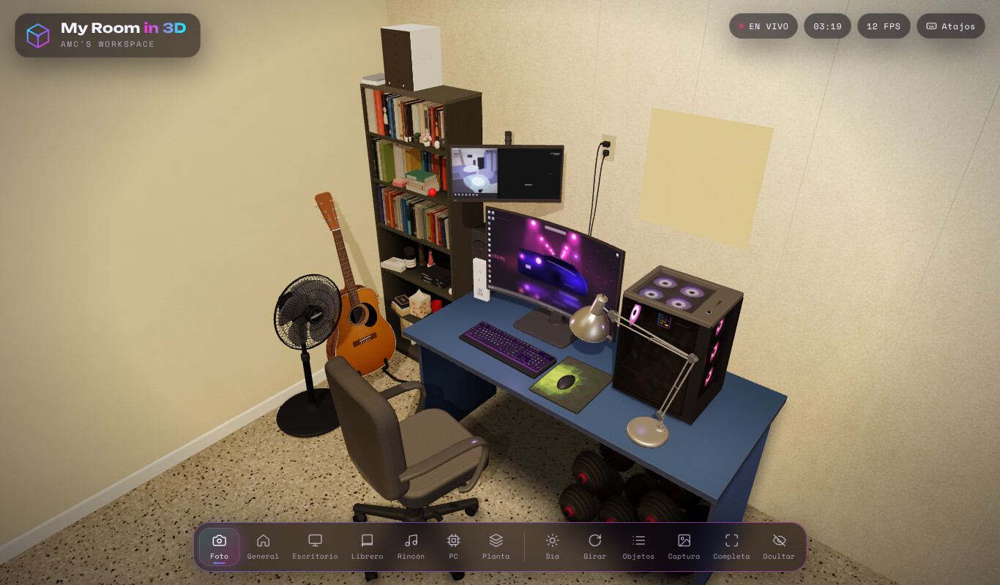

<div align="center">

# 🏠 My Room in 3D

**Mi cuarto gamer recreado en 3D, directamente en el navegador.**

[**▶ Ver en vivo**](https://antoniosanchezcaba.github.io/3DRoom/)




</div>

## ✨ Qué es

Una recreación 3D de mi espacio de trabajo a partir de una foto real: escritorio azul, monitor ultrawide curvo, PC con RGB, librero, guitarra, abanico, silla, pesas y piso de terrazo. Todo está modelado con código (sin modelos externos) y la cámara inicial reproduce el ángulo de la foto original.

## 🎮 Cómo usarlo

| Acción | Cómo |
| --- | --- |
| Girar / acercar / mover | Arrastrar / rueda / clic derecho (en móvil: arrastrar y pellizcar) |
| Ver un objeto | Clic o toque sobre él: la cámara vuela hacia él y muestra su ficha |
| Cambiar de vista | Barra inferior o teclas `1`–`7` |
| Modo día / noche | `T` |
| Rotación automática | `R` |
| Lista de objetos | `O` |
| Captura de pantalla | `P` |
| Pantalla completa | `F` |
| Ocultar interfaz | `H` |
| Ayuda | `?` |

## 🧱 Características

- 11 objetos modelados proceduralmente (texturas dibujadas con canvas, geometrías extruidas y curvas).
- Pantalla de carga con progreso real y entrada de cámara cinematográfica.
- 7 vistas de cámara con transiciones suaves, modo día/noche y luces RGB animadas.
- Interfaz de vidrio esmerilado, responsive (también en móvil).

## 📁 Estructura

```
index.html          Página y marcado de la interfaz
css/ui.css          Estilos de la interfaz
js/core.js          Renderer, cámara, luces, utilidades y registro de objetos
js/layout.js        Medidas y posiciones (en metros) y vistas de cámara
js/main.js          Lógica de la interfaz
js/objects/*.js     Un archivo por objeto (escritorio, PC, guitarra, ...)
```

## 🚀 Ejecutar en local

No necesita compilación. Sirve la carpeta con cualquier servidor estático:

```bash
python3 -m http.server 8000
# abre http://localhost:8000
```

## 🛠️ Tecnologías

Three.js r128 · JavaScript · HTML/CSS. Desplegado con GitHub Pages.

---

Hecho por [AntonioSanchezCaba](https://github.com/AntonioSanchezCaba).
